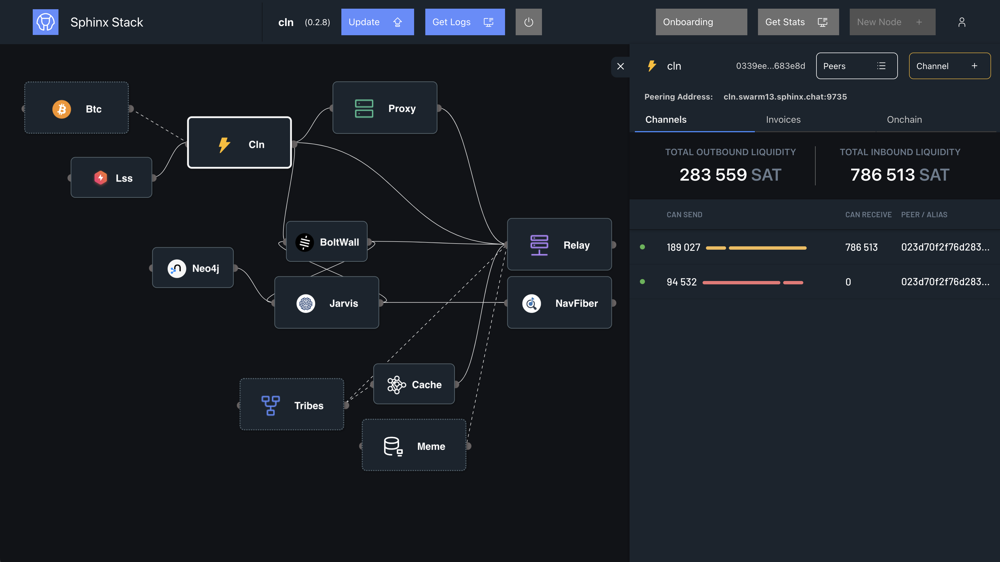

# sphinx-swarm

### stack

`cargo run --bin stack`

`cd app`

`yarn dev`

[http://localhost:5173/](http://localhost:5173/)

login with `admin`/`password`

### pull nodes down

`./clear.sh`

### Restart Swarm or services
If swarm goes down.

1. Find ec2 instance on aws (ex. sphinx-swarm-19) and reboot instance (**reboot only if you can't SSH into it**)
2. ssh into instance
3. `cd sphinx-swarm`
4. `./stop.sh jarvis` (optional if restarting just jarvis-backend)
5. `./restart.sh`

Other "stop" services are:

- neo4j
- elastic
- boltwall

For the whole list, you can do a `cat stop.sh` to see what's listed

### Anthropic without a static key (workload identity federation)

A swarm can run with no `ANTHROPIC_API_KEY`. The gateway container (bifrost, built
from stakwork/stakgraph `gateway/`) then authenticates to Anthropic with the EC2
instance profile (`sts:GetWebIdentityToken`, then `POST https://api.anthropic.com/v1/oauth/token`).
With a key set, nothing changes: the key wins and the variables below are ignored.

Set in the swarm's `.env` (the super writes them there for new swarms that get no
key from its pool, when its own env has them; `superadmin.yml` passes them in):

| Variable | Meaning |
| --- | --- |
| `ANTHROPIC_FEDERATION_RULE_ID` | `fdrl_…`, the federation rule in the Anthropic console |
| `ANTHROPIC_ORGANIZATION_ID` | Anthropic organization UUID |
| `ANTHROPIC_SERVICE_ACCOUNT_ID` | `svac_…`, the service account the token acts as |
| `ANTHROPIC_WORKSPACE_ID` | optional, needed when the rule spans several workspaces |
| `AWS_REGION` | region of the regional STS endpoint (already set in every swarm's `.env`) |

Federation is on when the key is empty and the first three are set. Then the bifrost
container gets all five, and repo2graph (stakgraph mcp) gets the four ids plus
`LLM_GATEWAY_URL=http://<bifrost>:8181`, because the mcp only reaches Anthropic through the gateway.

AWS side (not checked by sphinx-swarm):

- the instance role (`AWS_USER_ROLE`) must allow `sts:GetWebIdentityToken`, and outbound
  identity federation must be enabled for the account;
- the instance metadata `HttpPutResponseHopLimit` must be 2 so containers reach the
  instance profile (the default of 1 blocks them). `create_ec2_instance` already sets 2
  (`src/bin/super/util.rs`); instances created any other way need it set by hand;
- the federation rule in the Anthropic console must match the role's token claims
  (audience `https://api.anthropic.com`).
